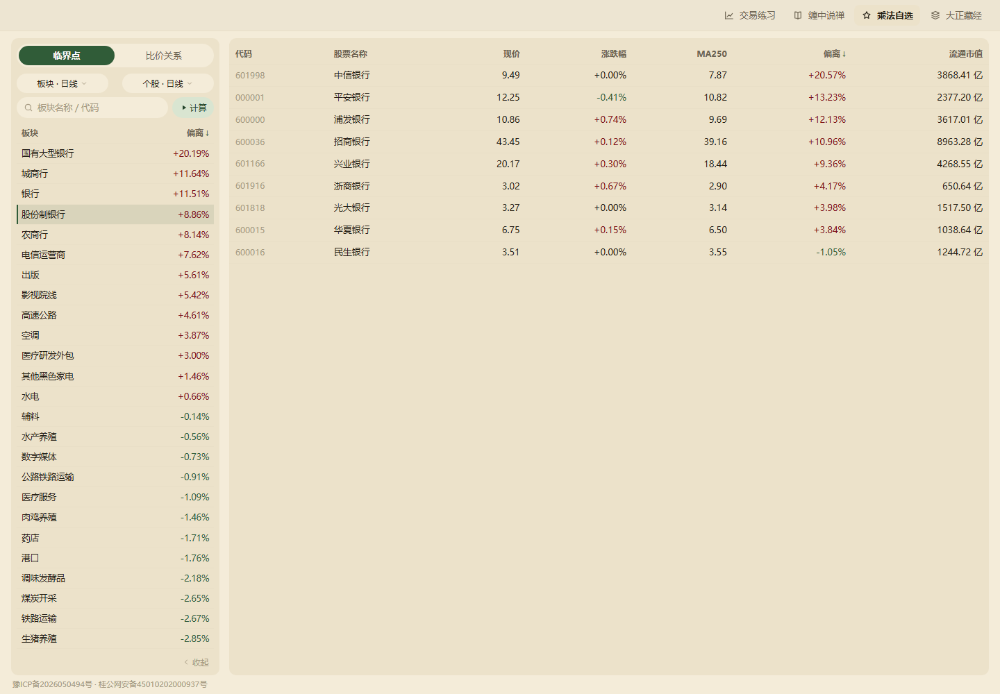
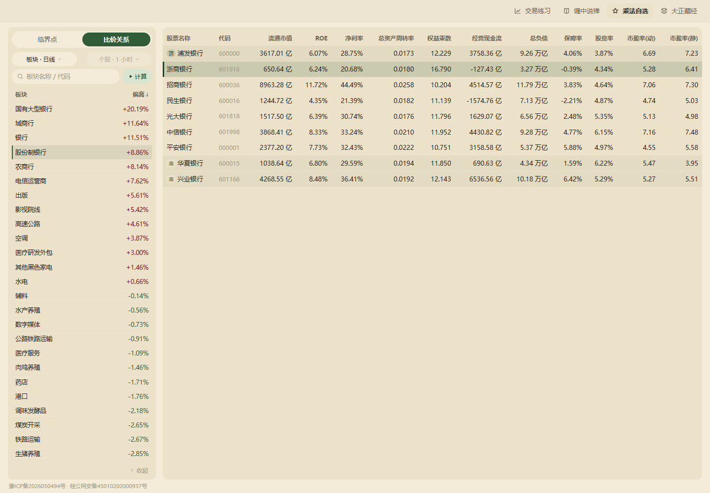
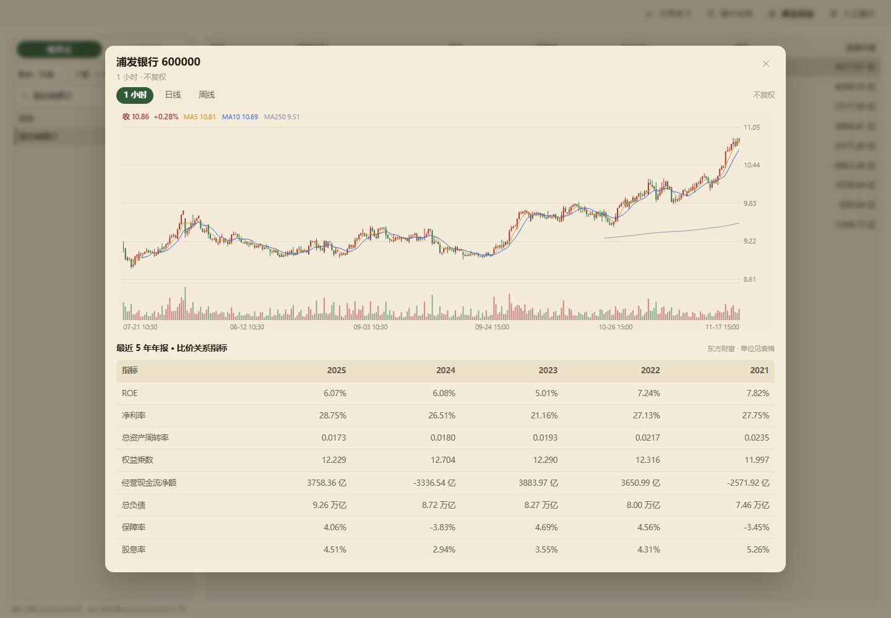

# 乘法自选（临界点 / 比价关系）

顶部菜单 **「乘法自选」** → <https://aibuilder.top/stocks/>；点击菜单时和交易练习 / 缠中说禅 / 大正藏经一样，
在首页轨道里**左右滑动切换**，不是整页刷新。直接打开 `/stocks/` 也能单独使用。





## 页面结构

- 左侧是一整块圆角色块，从上到下依次是：
  - 一个和下面搜索 / 计算区块**左右对齐**的胶囊，里面是 **临界点 / 比价关系** 两个等宽选项；
  - **板块 · 周期**、**个股 · 周期** 两个等宽胶囊下拉：中间间隔 20px，两个胶囊合计宽度和下面搜索 / 计算行一致；各自可选 1 小时 / 日线 / 周线；
  - 搜索图标在输入框内部（占位文字「输入板块名称」），右侧是 **计算**按钮；支持板块名称、代码和拼音首字母缩写（如 `yh` = 银行、`bdt` = 半导体）；
  - 320 个行业板块列表（未算过的显示「暂无」，算过的显示偏离度）。
  - 「偏离」字符左边紧挨着**刷新按钮**，点击强制重拉当前板块右侧的个股 / 比价数据；计算时这个位置让给进度条。
  - 左侧栏底部有「‹ 收起」：点一下左侧栏收成一条「板块」竖栏，点竖栏再展开；折叠状态会记住。
- 右侧也是一整块圆角色块，表格直接铺在里面；它的表头行和左侧胶囊处于同一水平线上。
- 右侧个股行单击会变成深绿色选中，双击打开个股走势与最近 5 年数据弹窗。
- 页面没有描边卡片、没有页面右侧滚动条；左右两块和所有控件都是圆角。
- 不再显示标题、说明、板块数量、缓存时间、计算用时、导出按钮、均线选择等额外信息；只在计算时显示进度条。
- 均线固定 **MA250**。

## 两个周期的区别

- **板块 · 周期**：只影响左侧 320 个板块的偏离度。
- **个股 · 周期**：只影响右侧板块内个股的偏离度和个股表。
- 两者互不影响。例如左侧看 1 小时板块强弱，右侧可以看日线个股偏离。
- 切到**比价关系**时，「个股 · 周期」按钮会自动灰显禁用：比价关系显示的是个股财务指标，不用个股 K 线周期；切回**临界点**后恢复可用。

## 比价关系：置顶 / 取消置顶 / 移到底部

- 在**比价关系**表里右键任意个股，会打开小菜单：
  - **置顶**：加入置顶组，可以同时置顶多只；
  - **取消置顶**：从置顶组回到普通组，单独操作，不用先移到底部；
  - **移到底部**：**任何标的都能用**，放到列表最底部的「底部组」；如果原来在置顶组，会同时取消置顶；
  - **移回上方**：把底部组的股票移回普通组。
- 列表分三段：**置顶组在上，普通组在中间，底部组在最下**。
- 点表头任意列排序时：
  - 置顶组内部按当前列排序；
  - 普通组内部按当前列排序；
  - 底部组保持移入顺序，后移入的更靠下，不参与排序。
- 置顶 / 底部状态按股票代码记在本机浏览器，刷新页面或换板块后仍然保留；当前板块里有这只股票就会按对应分组显示。

## 个股选中与双击走势弹窗

- 单击右侧个股行：整行变成**更深的绿色选中底**（比左侧板块选中更深），最左边有 3px 深绿竖条，方便看清是哪一只。
- 双击个股：从页面中间弹出这只股票的走势弹窗。
  - **临界点**双击：走势图 + 下方最近 5 年数据；
  - **比价关系**双击：只显示走势图，不显示最近 5 年数据。
  - 顶部一行依次是名称、**1 小时 / 日线 / 周线**、MA5 / MA10 / MA250、收盘价与涨幅、「不复权」；
  - 收盘价和涨幅不再悬浮在图上，也不单独占一行。
  - 默认 **1 小时**，蜡烛图 + MA5 / MA10 / MA250 + 成交量。
  - 鼠标移动只保留十字线，不再显示高开低收浮层。
  - 走势图可鼠标拖动或手指左右滑动，查看更早 / 更晚的 K 线。
  - 走势图左右两侧有上一只 / 下一只大箭头，移到图表外侧，避免挡住最新 K 线；按当前列表顺序切换相邻个股，到头时箭头变灰。
  - 下方「最近 5 年年报」默认折叠，只先显示走势图；点标题展开后才加载表格，
    标题右侧有刷新按钮，取数失败可手动重试。
  - 切换个股时仍保持默认折叠，不预先请求五年数据。
- 从**临界点**打开时，弹窗下方还有**最近 5 年年报的比价关系指标**：
  - ROE、净利率、总资产周转率、权益乘数、经营现金流净额、总负债、保障率、股息率；
  - 按年份列成表格，年份从新到旧。
- 关闭方式：右上角 ✕、点击遮罩、按 Esc；弹窗内部不显示右侧滚动条，内容多时用滚轮 / 触摸滚动。



## 计算规则

- **输入框有板块名称 / 代码 / 拼音首字母，点计算**：只计算这一个板块在「板块周期」下的偏离度；已经算过会提示「该板块已计算」。
- **输入框为空，点计算**：计算**全部 320 个板块**在「板块周期」下的偏离度。
  - 如果此时已经选中一个板块、且当前在**临界点**，还会同时重算该板块全部个股在「个股周期」下的偏离度。
- **点左侧任意板块**：按需计算它的板块偏离度（板块周期），然后加载右侧该板块全部个股（个股周期）。
- 计算中按钮从「▶ 计算」变成「❚❚ 暂停」，再点一下停止；左侧「板块」和「偏离」之间会显示进度条：全部板块计算按完成数量推进，单板块计算显示来回推进的动画。
- 网络断开、接口失败或右侧空表时，点「偏离」旁边的刷新按钮会强制重拉当前板块的个股 / 比价数据；如果上次加载为空，切回 tab 也会自动再试一次。
- 搜索框是可以直接编辑的文本块，不是浏览器表单输入框，因此不会被密码管理器自动填用户名；键盘、中文输入法、粘贴都可以正常输入。

## API Key

- 第一次打开时，左侧两个周期下拉的右边显示 **「设置 API」**。
- 保存成功后按钮消失，页面不再显示任何 API 信息。
- 只有 Key 失效 / 无权限时，按钮才会重新出现「重设 Key」。
- Key 只保存在本机浏览器，请求时由浏览器直接发给 `https://fuyao.aicubes.cn`，不经过本站服务器。
- 免费申请：<https://fuyao.aicubes.cn/admin/>。

## 缓存

| 数据 | 缓存键 | 说明 |
| --- | --- | --- |
| 板块偏离度 | 板块周期 | 只保留当天计算，过夜自动作废，下次计算前显示「暂无」 |
| 个股偏离度 | 代码 + 个股周期 | 30 分钟 |
| 比价关系成分股 | 板块代码 | 30 分钟 |

- 切换 tab、切换页面、刷新页面都直接读本机 `localStorage`，不会重算。
- 清浏览器数据或换设备后，板块重新显示「暂无」。

## 数据来源

| 用途 | 接口 | 是否需要 Key | CORS |
| --- | --- | --- | --- |
| 行业板块目录 | `GET /api/a-share-index/catalog/ths-index-list?tag=industry` | 是 | 同花顺按 Origin 回显，允许 |
| 日线板块 K 线 | `GET /api/a-share-index/prices/historical-batch` | 是 | 同上 |
| 1 小时 / 周线板块 K 线 | `https://d.10jqka.com.cn/v6/line/bk_<code>/50/...`、`/11/...` | 否 | `*` |
| 板块成分股 | `GET /api/a-share-index/constituents/ths-stock-list` | 是 | 同上 |
| 个股 60 分钟线 | `https://ifzq.gtimg.cn/appstock/app/kline/mkline` | 否 | `*` |
| 个股日线 / 周线 | `GET /api/a-share/prices/historical-batch` | 是 | 同上 |
| 个股实时快照 / 流通市值 / 市盈率 | `https://qt.gtimg.cn/q=` | 否 | `*` |
| 财务指标、分红 | `https://datacenter-web.eastmoney.com/api/data/v1/get` | 否 | `*` |

> 1 小时 / 周线的板块 K 线本身不需要 Key，但个股、成分股、日线都要用同花顺，所以页面统一先校验 Key。

## 财务口径

- ROE：归母净利润 ÷ 期末股东权益合计；分母缺失时退回加权 ROE。
- 净利率：归母净利润 ÷ 营业总收入。
- 总资产周转率：营业总收入 ÷ 总资产。
- 权益乘数：总资产 ÷ 股东权益合计。
- 保障率：经营现金流净额 ÷ 总负债。
- 股息率：近 12 个月每股税前分红合计 ÷ 现价。
- 市盈率(动)：腾讯行情的动态市盈率；市盈率(静)：总市值 ÷ 最近年报归母净利润，亏损显示「亏损」。
- 取最近一期**年报**；没有年报（如新上市）才退回最近报告期。

## 文件

| 路径 | 说明 |
| --- | --- |
| `site/stocks/index.html` | 页面结构（左侧整块、两个周期下拉、右侧表格） |
| `site/assets/stocks.css` | 圆角色块、无边框、无页面滚动条 |
| `site/assets/js/stocks.js` | 双周期、单板块 / 全部板块计算、缓存、个股 / 财务表 |
| `site/assets/data/stock-boards.json` | 320 个行业板块静态目录 |
| `site/index.html` | 首页 `stocksPane` iframe，左右滑动进入 |
| `site/assets/js/trade.js` | 首页轨道增加 `stocks` 一页 |
| `tools/build_site.py` | 顶部导航「乘法自选」+ `data-view="stocks"` |

## 本地预览

```powershell
python tools\build_site.py --sync
python -m http.server 8811 --directory site\dist
# 打开 http://127.0.0.1:8811/stocks/ 或首页点「乘法自选」
```

## 部署

```powershell
python tools\build_site.py --sync
tcb hosting deploy site/dist -e randeng-d8gs968w22a3d98e8
```

## 已知限制

1. **必须有同花顺 Key**：没有 Key 只能看到 320 个板块名称和「暂无」。
2. **全部板块计算较慢**：空输入点计算会扫 320 个板块；1 小时 / 周线约 20～40 秒，日线约 5～20 秒。计算中按钮变成暂停图标，「板块 / 偏离」中间显示进度条，全量计算按 320 个板块的完成数量推进。
3. **缓存是浏览器本地的**：换浏览器、清站点数据后会重新计算。
4. **历史窗口**：MA 固定 250；1 小时个股只有腾讯 320 根；周线个股走同花顺 1w。
5. **浏览器直连**：如果访客网络访问不了 `fuyao.aicubes.cn` / `d.10jqka.com.cn` / `qt.gtimg.cn` / `datacenter-web.eastmoney.com`，页面会提示取数失败，不是本站服务器的问题。
6. **走势图范围**：默认不复权，均线只保留 MA5 / MA10 / MA250；1 小时用腾讯最近 320 根；日线约最近 2 年；周线约最近 6 年。下方 5 年表是最近 5 份年报的比价指标，不是 5 年股价。
